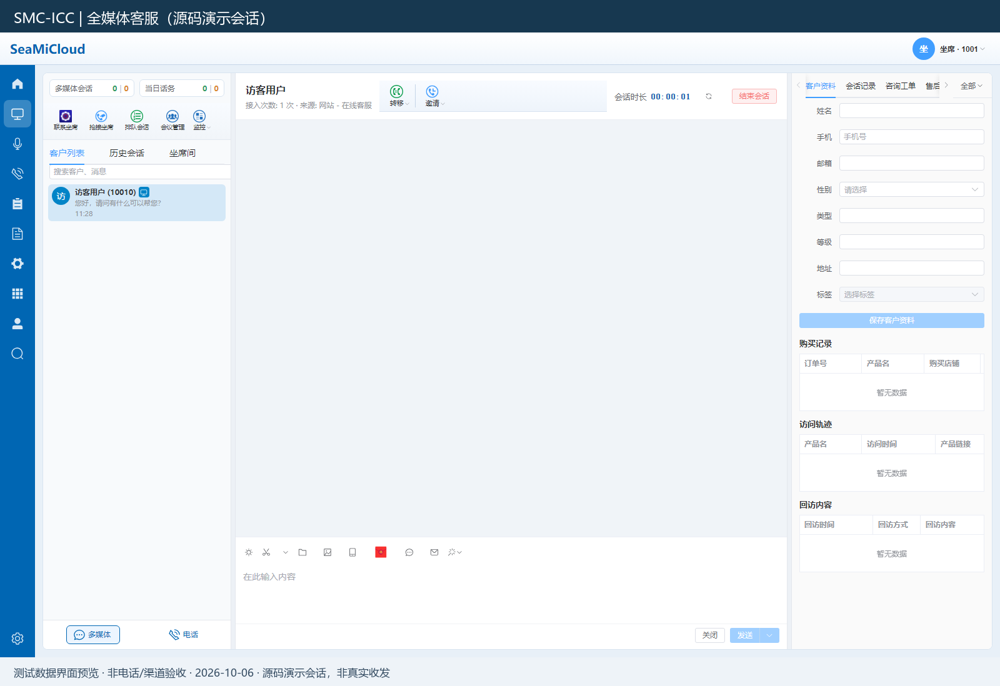
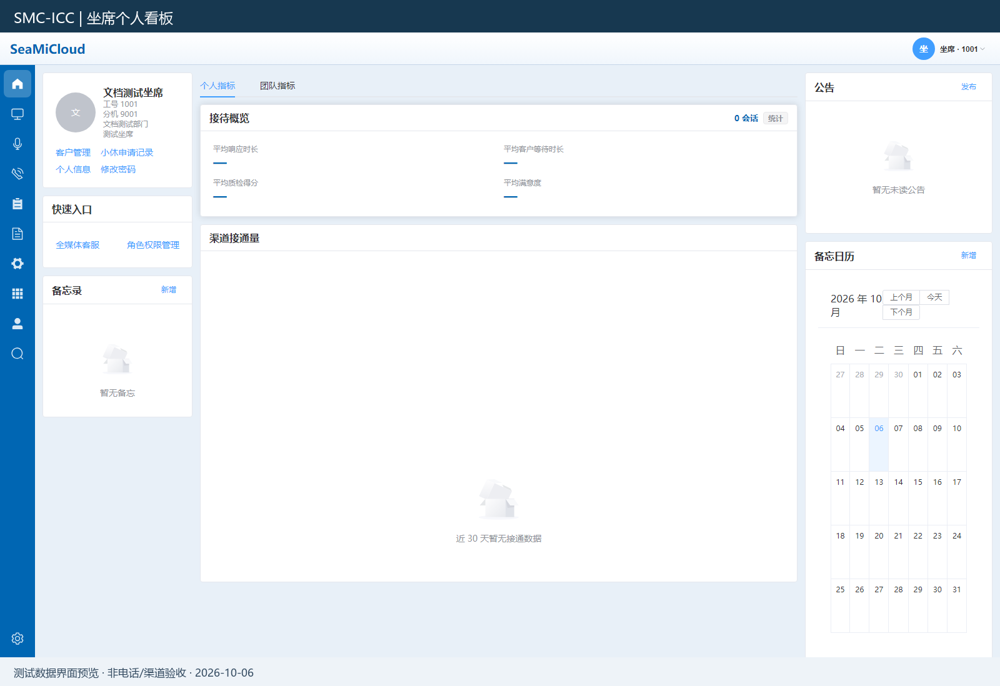
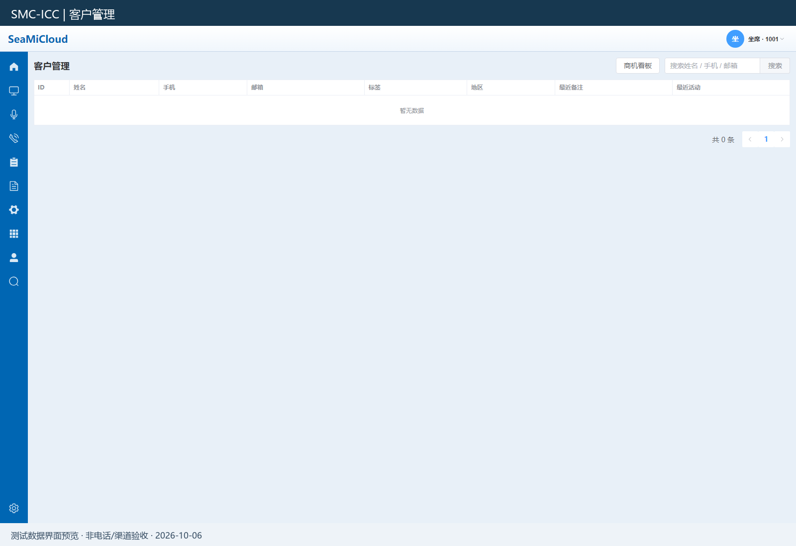
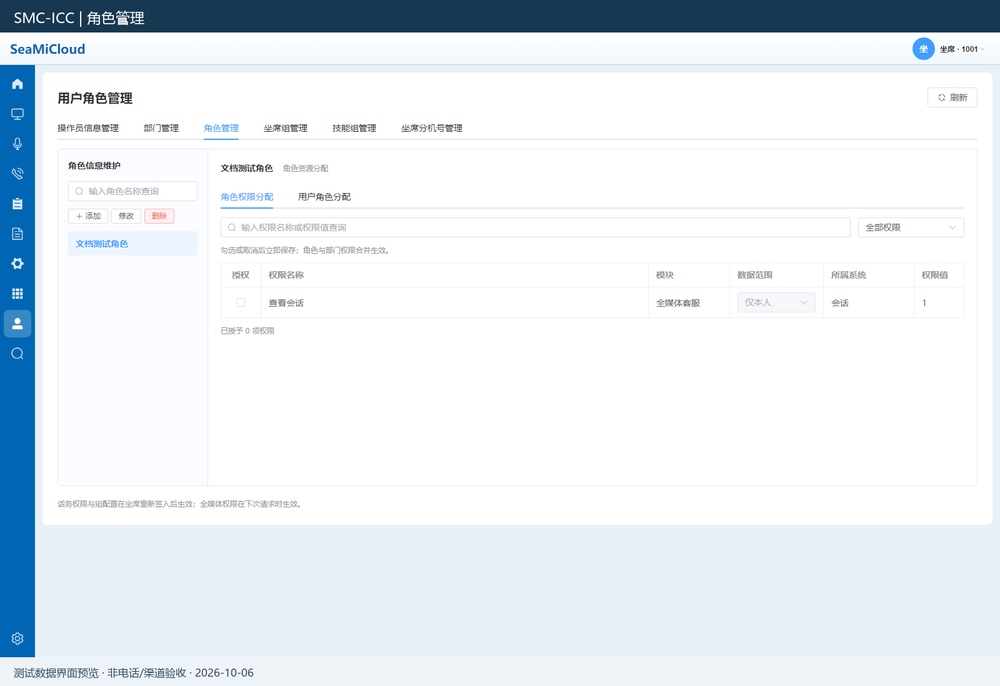
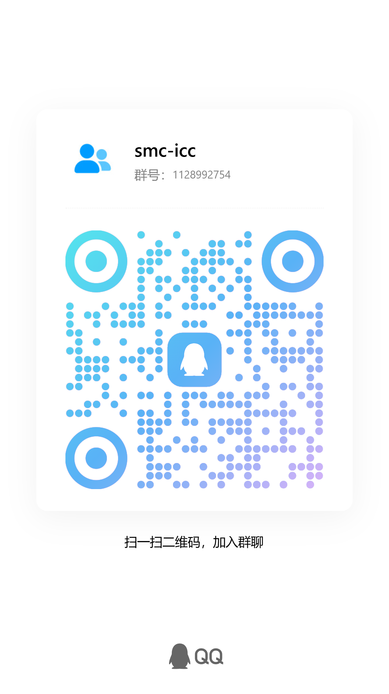

# OmniAgent Community

[中文](README.md)

OmniAgent customer-service、Call-Center platform. Agents handle online channels and contact-center calls in one workspace, and manage customer records, organization permissions, and everyday business entry points. [ConfServer](https://github.com/smc-icc/Confserver/tree/Community) configures tenants, channels, components, and editions.

**[User Guide](https://www.seami.cloud/page?code=user-guide&product=smc-icc)**

Each channel and the telephony path need platform credentials, backend services, and user permissions. A menu entry does not mean that external channel or call path is already connected.

## Features

### Channel access

Each channel has its own inbox and credentials. Conversations arrive in the same workspace:

- Website chat (Web Widget)
- API / app
- WeChat official account
- WeCom customer service
- WeCom contacts
- WeChat mini program
- Weibo
- Email
- SMS
- Twilio SMS
- WhatsApp
- Facebook
- Instagram
- TikTok
- Telegram
- LINE

After ICC is enabled, phone calls appear in the same conversation list.

### Omnichannel conversations

- Read the conversation list, messages, attachments, and history, and reply in place
- Queue a conversation, cancel the queue, requeue by skill, and pick up a waiting conversation
- Transfer the conversation to another agent
- Start an ITR flow
- Supervise a conversation: join, take over, observe, or force it to end
- Force sign-out, force busy, force idle, and force block
- Contact another agent and invite collaboration
- Send a satisfaction survey
- Open the customer profile, consulting tickets, after-sales tickets, store orders, knowledge base, and canned replies while handling the conversation
- Handle online and offline messages

### Contact center

With the ICC telephony component enabled, the workspace provides:

- Agent sign-in, busy, and idle
- Inbound calls, outbound calls, hold, and video calls
- Call transfer, including transfer to an agent and transfer to IVR
- Call queue and call pickup
- IVR menus and prompt playback
- TTS prompt playback
- Custom call flows
- Voice robot (ITR)
- Conference: create a conference, invite agents, and switch between talk/listen and listen-only
- Supervisor monitoring: listen, barge, intercept, and force hang-up
- Force sign-out, force busy, force idle, and force block
- Voicemail
- Outbound campaigns
- Quality inspection

Custom call flows are configured in ConfServer. Outbound campaigns and quality inspection require their own components.

### Workspace and administration

- One agent workspace for conversations, messages, and customer details
- Personal dashboard for service metrics, announcements, notes, and shortcuts
- Customer records: name, contact details, tags, and notes
- Organization and permissions: operators, roles, departments, and feature grants
- Optional knowledge assist through retrieval and model services

## Default account

Running `npx tsx src/seed.ts` in `backend` creates a demo agent. Use it only for a local demo, not in production.

| Item | Value |
|---|---|
| Account | `agent@demo.local` |
| Password | `demo123456` |
| Name | Agent Wang |
| Work number | `1001` |

The seed also creates Demo Company and four website inboxes: Tech Support, Sales, Billing, and General.

## Screenshots

The screenshots come from the user-guide sample environment and contain no real customer records. Menus follow the installed components and the signed-in user's permissions.

### Omnichannel workspace

The customer list, message editor, and customer profile stay in one workspace.



### Agent dashboard

Service metrics, announcements, notes, and shortcuts.



### Customer records

Maintain customer records, tags, notes, and contact details.



### Roles and permissions

Set feature grants and data scope by role.



## Layout

```text
backend/              Fastify, TypeScript, and Prisma API
frontend/             Vue agent workspace
tools/                Source export and checks
docs/community/       Community notes and screenshots
```

## Build

Use Node.js 22. Install each app with its own lockfile.

Backend:

```bash
cd backend
corepack enable
pnpm install --frozen-lockfile
pnpm prisma generate
pnpm build
```

Frontend:

```bash
cd frontend
npm ci
npm run build
```

Runtime needs PostgreSQL, Redis, and server credentials. See `backend/.env.example`. Telephony also needs the ConfServer capability endpoint, deployment id, and service token.

## Documentation

- **[User Guide](https://www.seami.cloud/page?code=user-guide&product=smc-icc)**: sign-in, conversations, customers, permissions, and telephony.
- [Community notes](docs/community/README.md): development setup and current limits.
- [ConfServer](https://github.com/smc-icc/Confserver/tree/Community): tenants, channels, editions, and components.

## Contact

- QQ group: **1128992754**
- Join the SMC-ICC group to share experience, report issues, and discuss features.

Scan the QR code with QQ, or search for the group number.



[Open the QR image](docs/community/contact/qq-group.png)

## License

Apache-2.0. See [LICENSE](LICENSE). Third-party dependencies and existing source notices keep their own licenses. See [THIRD_PARTY_NOTICES.md](THIRD_PARTY_NOTICES.md). Native SIP dependency licenses must be satisfied for the libraries actually linked and shipped.
