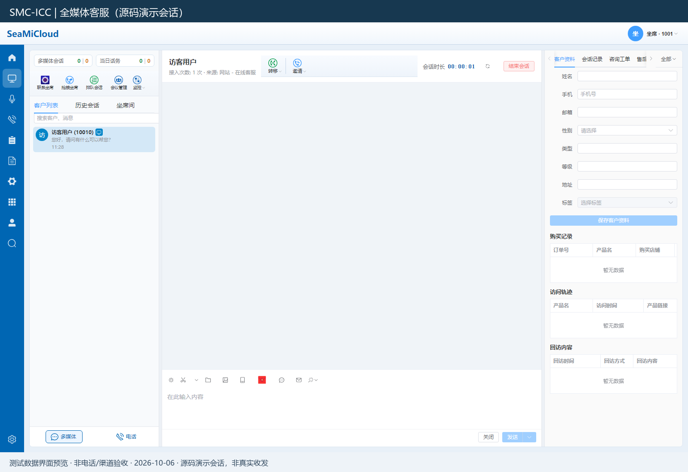
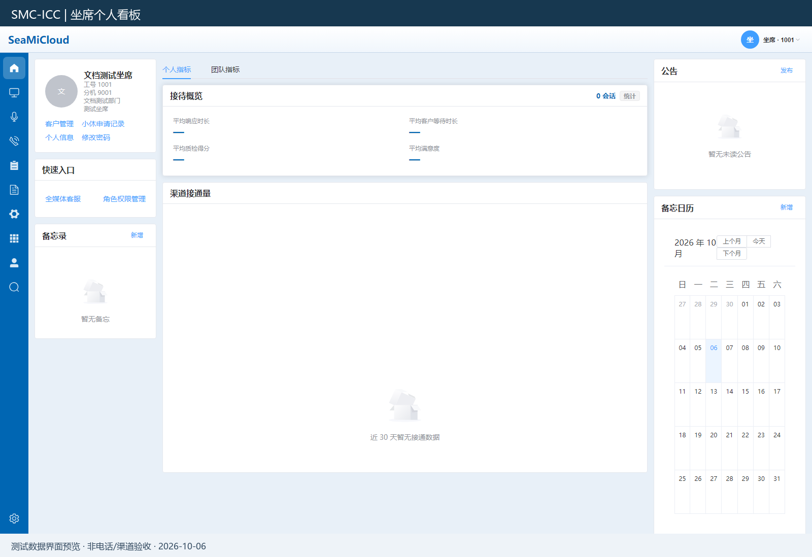
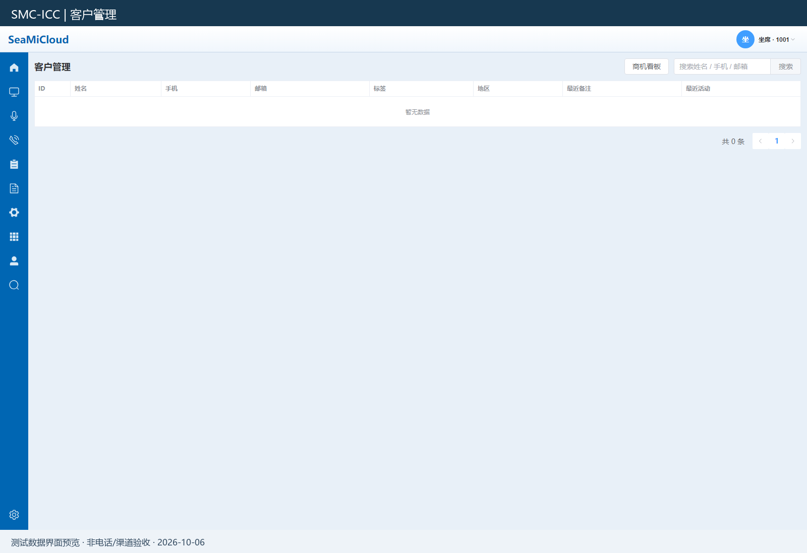
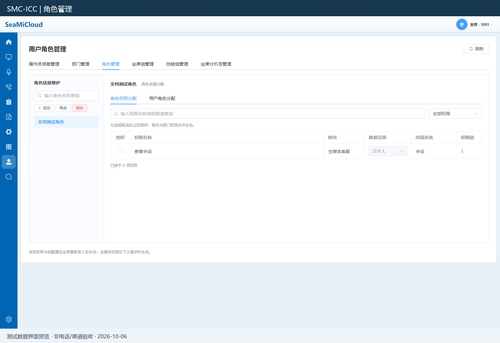
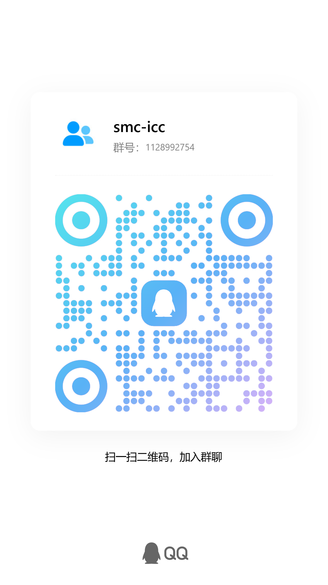

# OmniAgent Community

[English](README.en.md)

全媒体智能客服、呼叫中心平台。坐席在同一个工作台接待线上渠道和呼叫中心来话，并管理客户资料、组织权限和常用业务入口。配套的 [ConfServer](https://github.com/smc-icc/Confserver/tree/Community) 负责租户、渠道、组件和版本配置。

**[使用文档](https://www.seami.cloud/page?code=user-guide&product=smc-icc)**

渠道和话务都要先完成平台凭据、后端服务和用户权限配置。界面上有入口，不表示对应的外部渠道或通话链路已经接通。

## 主要功能

### 全媒体接入

每个渠道单独配置收件箱和凭据，会话进入统一工作台：

- 网站在线客服（Web Widget）
- API / APP
- 微信公众号
- 企业微信客服
- 企业微信通讯录
- 微信小程序
- 微博
- 邮件
- 短信
- Twilio 短信
- WhatsApp
- Facebook
- Instagram
- TikTok
- Telegram
- LINE

启用 ICC 后，电话来话也出现在同一会话列表中。

### 全媒体会话

- 查看会话列表、消息、附件和历史记录，并直接回复
- 排队、取消排队、按技能重新排队、抢接会话
- 转接给其他坐席
- 启动 ITR 流程
- 会话监控：加入会话、接管、旁观、强制结束
- 强制注销、强制示忙、强制示闲、强制闭塞
- 联系坐席、邀请协作
- 发送满意度评价
- 在接待中查看客户资料、咨询工单、售后工单、电商订单、知识库和快捷回复
- 处理在线留言和离线消息

### 呼叫中心

启用 ICC 话务组件后，工作台提供：

- 话务签入、示忙、示闲
- 呼入、外呼、保持和视频通话
- 呼叫转接，包括转坐席和转 IVR
- 电话排队和抢接
- IVR 语音导航和放音
- TTS 语音合成放音
- 自定义呼叫流程
- 语音机器人（ITR）
- 会议：创建会议、邀请坐席、听说 / 只听
- 班长监控：监听、强插、拦截、强制挂机
- 强制注销、强制示忙、强制示闲、强制闭塞
- 语音留言
- 智能外呼
- 智能质检

自定义呼叫流程在 ConfServer 中配置。智能外呼和智能质检需要安装对应组件。

### 工作台与管理

- 统一坐席工作台：会话、消息和客户资料放在同一界面
- 坐席个人看板：接待指标、公告、备忘录和常用入口
- 客户资料：姓名、联系方式、标签和备注
- 组织与权限：操作员、角色、部门和功能授权
- 可选知识辅助：对接知识检索和模型服务

## 默认账号

本地执行 `backend` 目录下的 `npx tsx src/seed.ts` 后，会写入演示坐席。这个账号只用于本地演示，生产环境不要使用。

| 项目 | 值 |
|---|---|
| 账号 | `agent@demo.local` |
| 密码 | `demo123456` |
| 姓名 | Agent Wang |
| 工号 | `1001` |

种子同时创建 Demo Company，以及 Tech Support、Sales、Billing、General 四个网站客服收件箱。

## 界面预览

截图来自使用文档的示例环境，不含真实客户记录。实际菜单以已安装组件和当前用户权限为准。

### 全媒体客服工作台

客户列表、消息编辑区和客户资料放在同一工作区。



### 坐席个人看板

接待指标、公告、备忘录和常用业务入口。



### 客户资料管理

维护客户资料，补充标签、备注和联系信息。



### 角色与权限管理

按角色设置功能授权和数据范围。



## 项目结构

```text
backend/              Fastify、TypeScript、Prisma 后端
frontend/             Vue 坐席工作台前端
tools/                源码导出与检查工具
docs/community/       Community 技术说明与界面截图
```

## 开发与构建

使用 Node.js 22。前后端分别用各自的锁文件安装依赖。

后端：

```bash
cd backend
corepack enable
pnpm install --frozen-lockfile
pnpm prisma generate
pnpm build
```

前端：

```bash
cd frontend
npm ci
npm run build
```

运行需要 PostgreSQL、Redis 和服务端凭据，示例见 `backend/.env.example`。接入话务还要配置 ConfServer 能力接口、部署标识和服务端认证令牌。

## 文档与相关项目

- **[完整使用文档](https://www.seami.cloud/page?code=user-guide&product=smc-icc)**：登录、会话接待、客户管理、权限和话务操作。
- [Community 技术说明](docs/community/README.md)：开发配置和当前实现边界。
- [ConfServer](https://github.com/smc-icc/Confserver/tree/Community)：租户、渠道、版本和组件管理。

## 联系方式

- QQ 群：**1128992754**
- 欢迎加入 SMC-ICC 交流群，交流使用经验、反馈问题与讨论功能需求。

使用 QQ 扫描下方二维码加入群聊，也可以通过群号搜索加入。



[查看二维码原图](docs/community/contact/qq-group.png)

## License

Apache-2.0，见 [LICENSE](LICENSE)。第三方依赖和已有源码声明仍遵循各自许可，见 [THIRD_PARTY_NOTICES.md](THIRD_PARTY_NOTICES.md)。原生 SIP 依赖的许可应按实际链接和交付内容单独满足。
