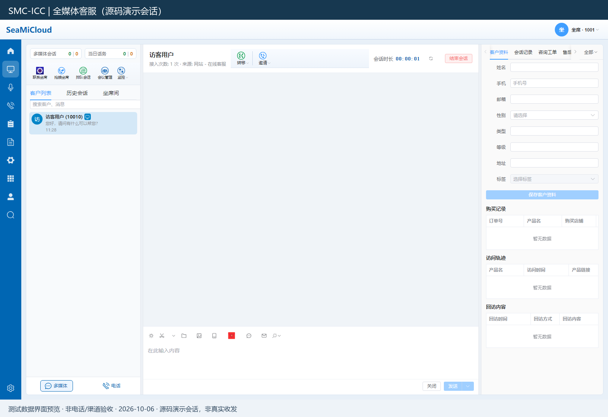
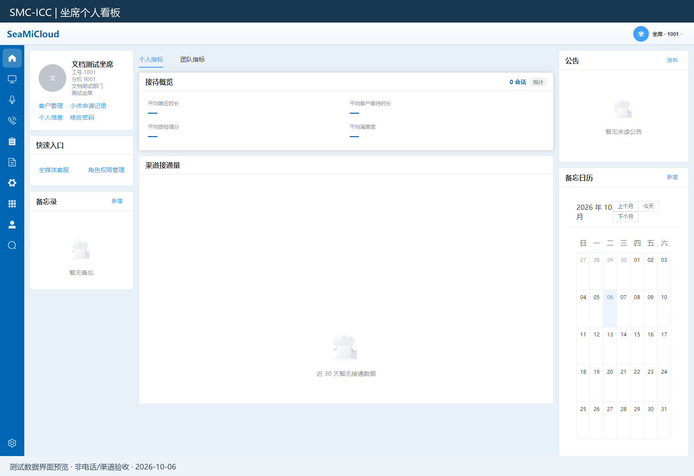
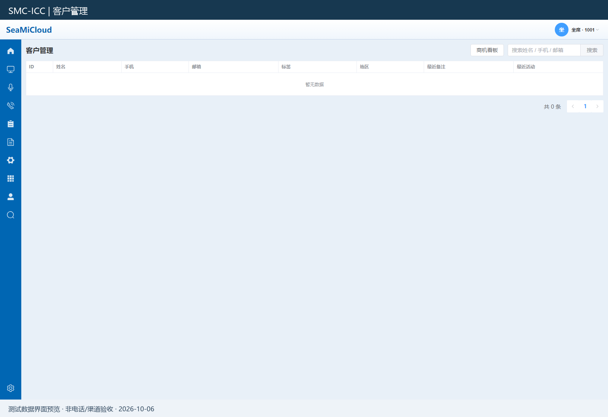
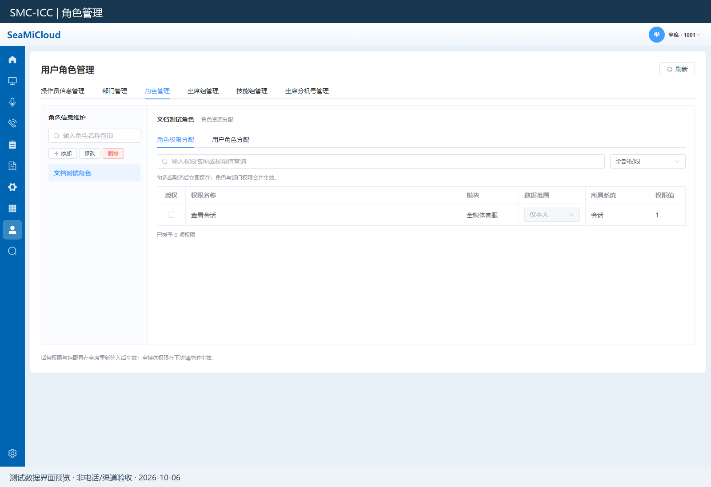
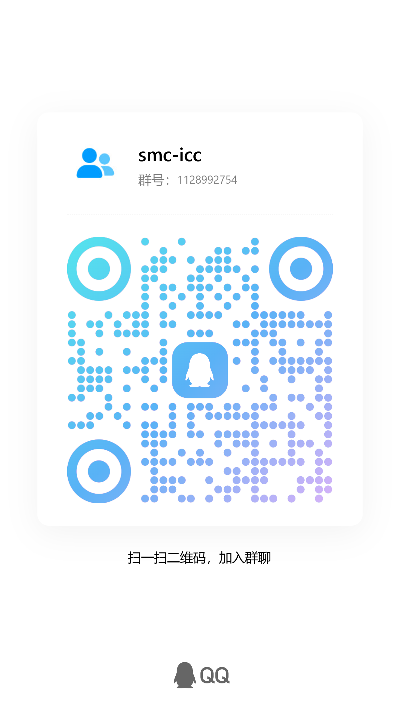

# OmniAgent Community

全媒体智能客服平台，提供统一坐席工作台、会话接待、客户资料与组织权限管理，并支持按授权扩展 ICC 语音、视频话务能力。

Omnichannel customer service platform with a unified agent workspace, conversation handling, customer management, and licensed ICC voice and video telephony integration.

**[使用文档 / User Guide](https://www.seami.cloud/page?code=user-guide&product=smc-icc)** · **[ConfServer 配置管理平台](https://github.com/smc-icc/Confserver/tree/Community)**

## 项目定位

OmniAgent 面向客服坐席和业务管理员，将渠道会话、客户资料及常用业务入口集中到同一个工作台。配套的 ConfServer 负责租户、渠道、组件和版本配置。

## 主要功能

| 功能 | 说明 |
|---|---|
| 统一坐席工作台 | 在一个界面查看会话列表、消息内容与客户信息，减少业务处理过程中的页面切换。 |
| 全媒体会话接待 | 统一处理已配置渠道的会话，支持消息回复、附件与会话历史查看；具体能力取决于对应渠道。 |
| 客户资料管理 | 查看和维护姓名、联系方式、标签、备注等资料，在接待过程中关联客户信息。 |
| 坐席个人看板 | 展示个人及团队指标入口、公告和常用业务快捷入口，便于了解接待情况。 |
| 组织与权限 | 管理操作员、角色、部门及功能授权，按角色和数据范围控制业务访问。 |
| 业务入口集成 | 通过业务导航和集成配置连接相关系统，按业务需求组织工作台入口。 |
| 可选知识辅助 | 可对接知识检索及模型服务，为客服业务提供辅助；需要配置相应服务。 |
| ICC 语音与视频 | 专业版、企业版安装并启用对应组件后，提供相关话务入口与集成能力。 |
| 智能外呼、智能质检 | 企业版按授权和组件安装情况提供对应业务能力。 |

渠道接入和业务能力需要正确配置平台凭据、后端服务及用户权限。界面提供相应入口不代表外部渠道或通话链路已经完成部署。

## 界面预览

以下截图来自使用文档的示例环境，不包含真实客户记录。部分演示菜单属于专业版或企业版，实际界面以授权、组件安装和用户权限为准。

### 全媒体客服工作台

将客户列表、消息编辑区与客户资料放在同一工作区中，便于持续接待和查询上下文。



### 坐席个人看板

集中查看接待指标入口、公告、备忘录和常用业务快捷入口。



### 客户资料管理

通过客户列表和查询入口维护客户资料，按业务需要补充标签、备注及联系信息。



### 角色与权限管理

按角色组织功能授权与数据范围，满足不同岗位的业务访问需求。



## 版本范围

| 能力 | 开源版 | 专业版 | 企业版 |
|---|---|---|---|
| Omni 线上全媒体客服 | 支持 | 支持 | 支持 |
| 会话工作台与客户管理 | 支持 | 支持 | 支持 |
| ICC 语音、视频与话务坐席 | 不包含 | 各 2 路并发 | 按授权文件配置 |
| 标准 IVR／ITR 流程运行 | 不包含 | 支持预置流程；IVR 可更换放音 | 支持 |
| IVR／ITR 可视化设计器 | 不包含 | 不包含 | 通过 ConfServer 安装企业插件后可用 |
| 智能外呼、智能质检 | 不包含 | 不包含 | 安装对应组件后可用 |

ICC 核心及企业流程设计器由独立商业组件或插件提供。OmniAgent 从 ConfServer 获取有效版本与功能能力，再结合用户权限展示对应入口。

## 项目结构

```text
backend/              Fastify、TypeScript、Prisma 后端
frontend/             Vue 坐席工作台前端
tools/                源码导出与检查工具
docs/community/       Community 技术说明与界面截图
```

## 开发与构建

使用 Node.js 22，前后端分别使用各自的锁文件安装依赖。

后端：

```bash
cd backend
corepack enable
pnpm install --frozen-lockfile
pnpm prisma generate
pnpm build
```

前端，从仓库根目录进入：

```bash
cd frontend
npm ci
npm run build
```

运行需要配置 PostgreSQL、Redis 及服务端凭据，配置示例见 `backend/.env.example`。开发种子与测试账号仅用于本地演示；接入商业功能还需配置 ConfServer 能力接口、部署标识和服务端认证令牌。

## 文档与相关项目

- **[完整使用文档](https://www.seami.cloud/page?code=user-guide&product=smc-icc)**：登录、会话接待、客户管理、权限及相关业务操作。
- [Community 技术说明](docs/community/README.md)：开发配置、版本能力及当前实现边界。
- [ConfServer](https://github.com/smc-icc/Confserver/tree/Community)：与 OmniAgent 配套的租户、渠道、版本及组件管理平台。

## 联系方式

- QQ 群：**1128992754**
- 欢迎加入 SMC-ICC 交流群，交流使用经验、反馈问题与讨论功能需求。

使用 QQ 扫描下方二维码加入群聊，也可以通过群号搜索加入。



[查看二维码原图](docs/community/contact/qq-group.png)

## License

Apache-2.0，见 [LICENSE](LICENSE)。第三方依赖和已有源码声明仍遵循各自许可，见 [THIRD_PARTY_NOTICES.md](THIRD_PARTY_NOTICES.md)。原生 SIP 依赖的许可应按实际链接和交付内容单独满足。
